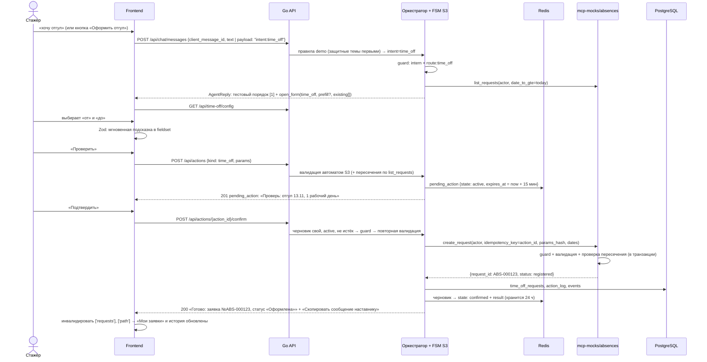
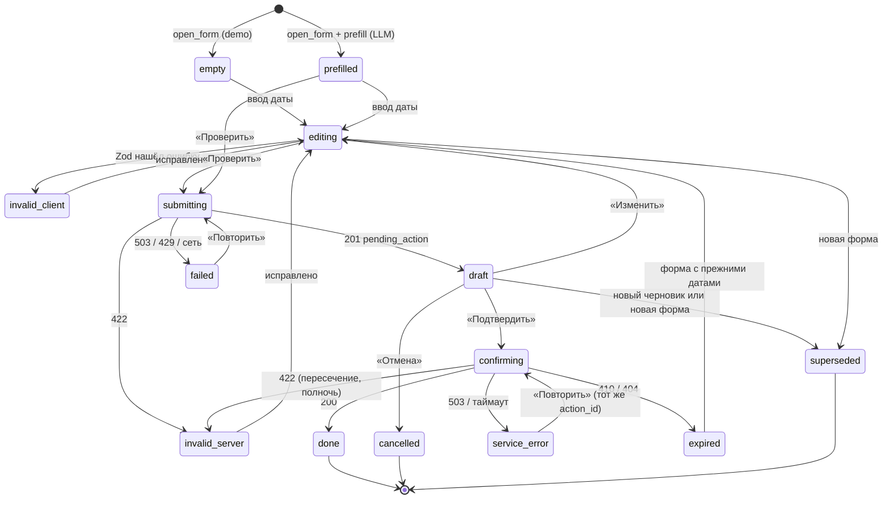

# Спецификация S3 «Оформление отгула»

Версия 1.3 · 11.11.2026 · статус: патч `17` перенесён (промт 3.0)
Источники: `02-decisions.md` v3.5, `09-spec-agent.md` v1.2 (AG-01…AG-26, вход чата §2.1, приоритет защитных тем §3.3, черновики §8.1, `AgentReply` §9, сбои LLM §13), `11-spec-s1-s2-s4.md` v1.0 (общие `actor`/`error`, «Мой путь», «Мои стажёры», `GET /api/requests`, база знаний), `08-intern-journey.md` (S3 — событие вне чек-листа), `01-case-brief.md` (пример с отгулом, ограничения 2, 3, 5, 6, 9, 10).
**S3 — часть основного сценария (S1 + S3): по нему проверяют допуск.** Всё, что здесь помечено `SHALL`, должно работать в `LLM_PROVIDER=demo` из чистого клона.
Окончательные пути, OpenAPI и схема БД — в `12-architecture.md`; матрица прав — в `13-permissions.md`. Если имена расходятся, правы `12`/`13`, а этот файл нужно поправить.

**Изменения v1.3 (Q&A 10.11 и архитектура 11.11, `17-qa-patch.md`):**
- Режим сбоя `slow` реализуется последним; если к C5 его нет — убирается из флага, демо-панели и README (§11.6).
- Статус `registered` имитации: в реальном сервисе согласование встроено, перевод статусов делает адаптер MCP-сервера (§11).
- Пути и имена по `12-architecture.md`: схемы — `contracts/…`, адрес `MCP_ABSENCES_URL` окончательный; ответ `confirm` — `{result: RequestView, reply: AgentReply}`; флаги имитаций — в `mock_admin.flags` через `MCP_MOCKS_ADMIN_URL`; вычисляемое состояние черновика `expired`; `Origin` — same-origin по `Host` или `ALLOWED_ORIGINS`; тесты гонок — на PostgreSQL из compose.
- OpenSpec: требования — в `openspec/changes/add-time-off/specs/time-off/spec.md` как `ADDED Requirements`, в `openspec/specs/` их переносит `openspec archive` после реализации (§15, §18).
- Правки к `09` и `11` из §19 перенесены (`09` v1.3, `11` v1.1).

**Изменения v1.2 (ревью):**
- Вход по `09` §2.1: `POST /api/chat/messages` с `client_message_id` и ровно одним из `text`/`payload`; кнопки «Оформить отгул» шлют `payload: "intent:time_off"` с новым `client_message_id`; повтор того же id не открывает вторую форму и не дублирует события (§5.1).
- **Исправлено противоречие с `09` §3.3:** «отгул, у меня температура» больше не открывает форму — это защитная тема `sick_leave` (A25). Добавлены отрицание («отгул не нужен») и два намерения в одном сообщении.
- **Исправлено противоречие внутри черновиков:** раньше черновик удалялся после `confirm`, и повторный `confirm` (двойной клик) получал 404 вместо того же номера; истёкший ключ Redis исчезал, и 410 был невозможен. Теперь у черновика есть состояния и срок хранения 24 ч (§8.1).
- Гонка двух одновременных `confirm` одного черновика закрыта уникальным индексом по `idempotency_key` в mock (§11.2).
- Сбои LLM по AG-24: неполная конфигурация и ключ, отклонённый с 401/403, не мешают S3 (A28, AC-34, AC-35).
- `POST /api/actions` при сбое `list_requests` больше не отвечает 503 с созданным черновиком (противоречие): 201 + `notices: ["overlap_unchecked"]`.
- История — через общий `GET /api/requests` из `11` вместо отдельного `GET /api/time-off/requests`; наставник видит предстоящие отгулы своих стажёров в «Моих стажёрах» — иначе текст ответа наставнику (A12) обещал то, чего нет.
- У полей даты больше нет атрибутов `min`/`max`: нативная проверка браузера мешала показать наши ошибки и шаг README «выбери вчерашний день».
- Событие отказа наставнику — `permission_denied{tool: "route:time_off"}`, как в `09` §3.1.
- Безопасность: CSRF/`Origin`, rate-limit на действия, белый список флагов демо-панели, проверка ответа MCP по `outputSchema`.
- Внедряемость: адрес `MCP_ABSENCES_URL`, `request_id` в `_meta`, адаптер статусов реального сервиса.
- +11 критериев приёмки (AC-33…AC-43), +18 тест-кейсов.

---

## 1. Цель и ценность

**Цель.** Стажёр оформляет отгул за одну минуту: узнаёт тестовый порядок, выбирает даты в форме «от — до», видит черновик, подтверждает кнопкой. Заявка создаётся в имитации корпоративного сервиса отсутствий, а её номер и статус отображаются, сохраняются и видны в «Моём пути» и в истории.

**Почему это важно для кейса.** Это пример из самого кейса и единственное в основном сценарии действие через корпоративный сервис («результат возвращается, отображается и сохраняется»). На нём эксперт проверяет допуск и критерии «Работоспособность» (20%), «Внедряемость» (30%, MCP-контракт), «UX» (25%, форма и состояния).

**Ценность.** Наставнику не нужно объяснять, как оформить отгул. Каждая заявка через бадди — оргдействие, которое учитывается в формуле сэкономленных часов (`action_completed{kind: time_off}` × T₂). Общение с наставником бадди не заменяет: после оформления он напоминает предупредить наставника и даёт готовый текст сообщения. Наставник видит предстоящие отгулы своих стажёров на своём экране.

---

## 2. Акторы

| Актор | Роль | Что делает в S3 |
|---|---|---|
| Стажёр (`intern`, любой трек) | основной | Оформляет отгул, видит свои заявки |
| Наставник (`mentor`) | второстепенный | Видит предстоящие отгулы своих стажёров на экране «Мои стажёры» (только чтение). Сам отгул через бадди не оформляет: в MVP у наставника нет своего пути (`02`, «Роли») |
| Бадди «Авиитик Витя» (Go-оркестратор + автомат S3) | система | Объясняет порядок, проверяет даты, создаёт черновик, после подтверждения вызывает MCP |
| `mcp-mocks`, endpoint `absences` | внешняя система (имитация) | Повторно проверяет права и даты, хранит заявки, выдаёт номер и статус |

---

## 3. Предусловия

1. Стек поднят `docker compose up`; `api`, `mcp-mocks`, `postgres`, `redis` прошли healthcheck.
2. Пользователь вошёл тестовой учёткой; `user_id` и `role` лежат в сессии (Redis, cookie `HttpOnly`) и в каждый вызов передаются из неё (AG-03).
3. В базе знаний есть документ `time-off-test-order` (`source_level: team`, `label: test_instruction`; содержимое — §6.4).
4. «Сегодня» вычисляется на сервере в `TZ=Europe/Moscow` через интерфейс `Clock` (в тестах он подменяется).
5. Сиды демо (относительно сегодняшнего дня): у демо-стажёра Backend одна заявка `registered` на понедельник и вторник через три недели. Она нужна, чтобы блок «Мои заявки» не был пустым и чтобы показать пересечение (§12.4). Оба демо-стажёра закреплены за одним наставником (`11` §0.1).
6. LLM не нужна. При `openai_compatible` модель только предзаполняет даты, решения принимает автомат. Неполная конфигурация LLM или отклонённый ключ на S3 не влияют (AG-24).

---

## 4. Вне скоупа (в README и roadmap)

- Отмена и изменение созданной заявки. В README: «в прототипе заявку нельзя отменить; для демо — „Сбросить демо-данные“».
- Баланс отгулов, виды оплаты, отпуск, больничный (AG-13; отпуск и больничный — `out_of_scope`, `09` §11.4).
- Производственный календарь: праздники не учитываются, нерабочими считаются только суббота и воскресенье. Это сказано в тексте тестового порядка.
- Отгул на часть дня.
- Согласование руководителем и автоматическое уведомление наставника. Бадди даёт черновик сообщения с кнопкой «Скопировать».
- Отгул наставника.
- Разбор дат из текста в `demo` (известное ограничение, `09` §6.3).

---

## 5. Основной поток



Шаги:
1. **Вход** — одно из четырёх:
   - сообщение, которое правила `demo` (или модель) распознают как `time_off`: «отгул», «отпроситься», «взять выходной» (`09` §6.2);
   - быстрый ответ «Оформить отгул» из меню `help`;
   - быстрый ответ «Оформить отгул» после ответа про отпуск (`out_of_scope/vacation`, `09` §11.4);
   - кнопка «Оформить отгул» в блоке «Мои заявки» панели «Мой путь».

   Кнопки и быстрые ответы отправляют `payload: "intent:time_off"` с **новым** `client_message_id`; сервер берёт намерение без распознавания (`intent_recognized{source: button}`). В истории чата нажатие показывается подписью кнопки «Оформить отгул» (`09` §2.1).
2. **Объяснение порядка.** Шаблон `09` §9.3 «`time_off`, старт» с источником `[1]` = `time-off-test-order` и плашкой «тестовый порядок, не регламент Авито». В том же ответе есть действие `open_form`. Если `list_requests` вернул предстоящие заявки, в действии есть `existing: [{request_id, date_from, date_to}]` (до 3) — форма показывает подсказку «У тебя уже есть отгул 16.11–17.11».
3. **Форма «от — до»** (§9) открывается в чате карточкой. В `demo` она пустая. В `openai_compatible` поля предзаполнены датами модели, если те прошли проверку формата (`09` §3.3), а под полями написано «Подставил даты из сообщения — проверь».
4. **Проверка на клиенте** (Zod, те же правила, что в Go, общий набор тест-векторов, §16.1). Ошибка показывается в fieldset сразу после выбора даты, без запроса к серверу. Это подсказка, а не источник истины.
5. **Отправка формы** → `POST /api/actions`. Автомат S3 в Go проверяет все правила §6 и пересечения с заявками стажёра. Ошибки → `422` с ошибками по полям, форма остаётся открытой. Успех → черновик действия в Redis (§8.1).
6. **Карточка-черновик**: «Проверь: отгул {{дд.мм}}–{{дд.мм}}, {{N}} рабочих дня. Ничего не отправлю, пока не нажмёшь „Подтвердить“». Кнопки «Подтвердить», «Изменить», «Отмена».
7. **Подтверждение** → `POST /api/actions/{action_id}/confirm` (§8.1): черновик свой, `active` и не истёк → повторный guard → повторная валидация (за время черновика могла смениться дата или появиться заявка из другой вкладки) → `absences.create_request` с `idempotency_key = action_id`.
8. **Результат.** Номер и статус показываются в карточке «Готово» (Витя в состоянии `done`). Заявка сохраняется в нашей БД (`time_off_requests`, `action_log`), появляется в блоке «Мои заявки» в «Моём пути» и в истории `/requests`. Черновик переходит в `confirmed` и хранит результат: повторное нажатие вернёт тот же номер.
9. **Не заменяем наставника.** Под карточкой есть кнопка «Скопировать сообщение наставнику» с готовым текстом: «Привет! Оформил(а) отгул на {{дд.мм}}–{{дд.мм}} (заявка {{request_id}}). Если до этого нужно что-то передать — скажи.» Наставник также увидит отгул в «Моих стажёрах» (§12.2).

### 5.1 Вход, повторы и история
- **`client_message_id`.** Повтор того же id от того же пользователя в течение 10 мин возвращает сохранённый `AgentReply` (тот же `reply_id`): вторая форма не открывается, `time_off_form_opened` и `intent_recognized` не публикуются повторно (`09` §2.1). Так «Повторить» после обрыва сети безопасен.
- **Одна активная форма.** Новая форма отгула в чате делает предыдущие карточки формы неактивными с подписью «Открыта новая форма ниже». Активный черновик при этом не трогается: его заменит только новый `POST /api/actions` (A21).
- **История (`GET /api/chat/history`).** Карточка формы из истории всегда неактивна и показывает кнопку «Оформить отгул» (новый `payload` с новым id). Карточка черновика показывает актуальное состояние из `GET /api/actions/{action_id}` (§10): `active` — кнопки работают; `confirmed` — номер заявки; `expired`/`cancelled`/`replaced` — подпись без кнопок.
- **Защитные темы важнее отгула.** Правила `demo` проверяют `out_of_scope` первыми, а в режиме LLM защитные темы правил побеждают модель (`09` §3.3, §6.3). Поэтому «у меня температура, хочу отгул» и «хочу больничный» дают шаблон `sick_leave` без формы (A25).
- **Отрицание и два намерения** (`09` §6.3): «отгул мне пока не нужен» — не `time_off`; «хочу отгул и доступ в tech-dep» — форма отгула и быстрый ответ «Запросить доступ: Канал Tech-dep».

---

## 6. Правила проверки дат

### 6.1 Правила
Даты — строки `YYYY-MM-DD`, интервал `[date_from, date_to]` включительно. `today` — сегодняшняя дата в Europe/Moscow. Рабочий день — понедельник–пятница.

| Код | Условие ошибки | Поле | Где проверяется |
|---|---|---|---|
| `REQUIRED` | поле пустое | `date_from` / `date_to` | Zod, API, mock |
| `INVALID_DATE` | не парсится как реальная дата (`2026-02-30`) | поле | Zod, API, mock |
| `DATE_IN_PAST` | дата `< today` (сегодня — можно) | поле | Zod, API, mock |
| `TOO_FAR` | дата `> today + 90 дней` | поле | Zod, API, mock |
| `WEEKEND_DATE` | дата приходится на субботу или воскресенье | поле | Zod, API, mock |
| `RANGE_REVERSED` | `date_to < date_from` | форма (`range`) | Zod, API, mock |
| `TOO_LONG` | рабочих дней в интервале больше 5 | форма (`range`) | Zod, API, mock |
| `OVERLAP` | интервал пересекается с заявкой стажёра в статусе `registered` | форма (`range`) | API (по `list_requests`), mock (в транзакции) |

Выходные внутри интервала разрешены и не считаются: пятница–понедельник = 2 рабочих дня. Требование «начало и конец — рабочие дни» избавляет от заявок вида «суббота–воскресенье» (0 рабочих дней) и делает подсчёт однозначным.

### 6.2 Порядок проверки
1. Поля по отдельности: `REQUIRED` → `INVALID_DATE` → `DATE_IN_PAST` → `TOO_FAR` → `WEEKEND_DATE`. На поле — первая сработавшая ошибка.
2. Если оба поля без ошибок: `RANGE_REVERSED` → `TOO_LONG`.
3. Если ошибок нет: `OVERLAP` (только на сервере).

Валидатор возвращает упорядоченный список нарушений `[{field, code, params}]`. UI показывает не больше одной ошибки у каждого поля и одну ошибку формы.

### 6.3 Реализация без расхождений
- Go: пакет `internal/timeoff/rules` — чистые функции `Validate(req, today) []Violation` и `WorkingDays(from, to) int`, без I/O. Его используют и оркестратор, и `mcp-mocks`. В проде реальный сервис проверяет сам, а агент обязан корректно разобрать его `VALIDATION_FAILED` (§11.5).
- Фронт: `src/features/time-off/schema.ts` — Zod-схема с `superRefine`, те же коды.
- Арифметика дат на фронте — только с датами без времени (`Date.UTC`, `getUTCDay`), чтобы часовой пояс браузера эксперта не сдвигал день недели. `today`, `max_date` и лимиты фронт берёт из `GET /api/time-off/config`, а не из часов браузера.
- Общие тест-векторы `docs/specs/s3/validation-cases.json` прогоняются и в Go, и в Vitest (§16.1). Если правило поменяется только в одном месте, упадёт тест.

### 6.4 Документ базы знаний `time-off-test-order` (синтетический)
Front matter по `11` §2.5.1: `slug: time-off-test-order`, `title: Как оформить отгул (тестовый порядок)`, `kind: guide`, `source_level: team`, `allowed_roles: [intern, mentor]`, `tags: [отгул, отпроситься, выходной, заявка на отгул]`. Плашка «Тестовый порядок, не регламент Авито». Содержание, 5 пунктов:
1. Заранее предупреди наставника и руководителя — сам, бадди этого не делает.
2. Оформи заявку через бадди: выбери даты, проверь черновик, нажми «Подтвердить».
3. В тестовом сервисе отгул длится до 5 рабочих дней, начинается и заканчивается в рабочий день, даты — не раньше сегодняшнего дня и не дальше чем на 90 дней вперёд. Праздники тестовый сервис не учитывает.
4. Причину указывать не нужно.
5. Для более долгого отсутствия (отпуск, болезнь) поговори с руководителем — бадди такие заявки не оформляет.

`summary`: «По тестовому порядку отгул — до 5 рабочих дней, с рабочего дня по рабочий день, не дальше 90 дней вперёд; причину указывать не нужно, наставника предупреди сам.»

---

## 7. Альтернативные потоки и ошибки

Тексты — шаблоны `demo`. Переформулировка моделью для отказов, ошибок и карточек черновиков не вызывается (`09` §7). Ошибки валидации показываются в fieldset, Витя остаётся в `hello` (`09` §10.2).

| # | Ситуация | Где ловится | HTTP API | Текст для пользователя | Витя | Событие | Что дальше |
|---|---|---|---|---|---|---|---|
| A1 | Дата в прошлом | Zod / автомат / mock | 422 | «Дата уже прошла — выбери сегодня или позже» | `hello` | `time_off_validation_failed{codes}` | Исправить поле |
| A2 | «До» раньше «от» | Zod / автомат / mock | 422 | «„До“ не может быть раньше „от“» | `hello` | то же | Исправить |
| A3 | Выходной на границе | Zod / автомат / mock | 422 | «{{дд.мм}} — {{суббота\|воскресенье}}. Отгул начинается и заканчивается в рабочий день» | `hello` | то же | Исправить |
| A4 | Больше 5 рабочих дней | Zod / автомат / mock | 422 | «Выбрано {{N}} рабочих дней, а в тестовом сервисе можно до 5. Для долгого отсутствия поговори с руководителем» | `hello` | то же | Сократить период |
| A5 | Дальше 90 дней | Zod / автомат / mock | 422 | «Можно выбрать дату не позже {{дд.мм.гггг}}» | `hello` | то же | Исправить |
| A6 | Пустое поле / невалидная дата | Zod / автомат | 422 | «Укажи дату» / «Не похоже на дату» | `hello` | то же | Заполнить |
| A7 | Пересечение с существующей заявкой | автомат (при черновике), mock (при создании) | 422 | «Пересекается с заявкой {{request_id}} на {{дд.мм}}–{{дд.мм}}» + ссылка на заявку | `hello` | то же, `codes: [OVERLAP]` | Изменить даты |
| A8 | Пересечение появилось между черновиком и подтверждением (вторая вкладка) | повторная валидация при `confirm` или mock | 422 | Как A7; карточка-черновик возвращается в форму с теми же датами | `hello` | `action_failed{error_code: OVERLAP}` | Изменить даты |
| A9 | Черновик стал невалидным после полуночи (дата «от» ушла в прошлое) | повторная валидация при `confirm` | 422 | Как A1; карточка возвращается в форму | `hello` | `action_failed{error_code: DATE_IN_PAST}` | Исправить |
| A10 | Сервис отсутствий недоступен | mock `UNAVAILABLE` или ошибка соединения | 503 | «Ой, сервис отсутствий сейчас не отвечает, заявка не создана. Попробуй ещё раз — дубликата не будет.» + «Повторить» | `oops` | `action_failed{error_code: UNAVAILABLE}` | «Повторить» с тем же `action_id` |
| A11 | Таймаут вызова (`MCP_TIMEOUT_MS`, по умолчанию 3000) | оркестратор | 503 | Как A10. Результат неизвестен: заявка могла создаться | `oops` | `action_failed{error_code: TIMEOUT}` | «Повторить»: mock вернёт уже созданную заявку (`idempotent_replay: true`), дубликата нет |
| A12 | Нет прав: наставник пишет «хочу отгул» или нажимает кнопку с `intent:time_off` | guard оркестратора по роли (`09` §3.1) | 200 (ответ агента) | «Это сценарий для стажёров. Предстоящие отгулы стажёров — на экране „Мои стажёры“» + ссылка | `hello` | `permission_denied{tool: "route:time_off", role: mentor}` | — |
| A13 | Нет прав: прямой `POST /api/actions {kind: time_off}` от наставника | middleware API + guard | 403 | «Оформлять отгул может только стажёр» (UI наставника такой кнопки не показывает) | — | `permission_denied{tool: absences.create_request}` | — |
| A14 | Нет прав: в mock пришёл `actor.role ≠ intern` (обход оркестратора, в том числе `system`) | guard в `mcp-mocks` | — (MCP-ошибка) | — | — | лог `mcp_permission_denied` | Покрыто тестом mock |
| A15 | Чужой или несуществующий `action_id` (в том числе после «Сбросить демо-данные») | API | 404 | «Черновик не найден — давай заполним заново» + форма | `oops` | — | Новая форма. Чужой черновик не отличается от несуществующего, его существование не раскрывается |
| A16 | Черновик истёк (15 мин) | API по `expires_at` (§8.1) | 410 | «Черновик устарел — давай заполним заново» + форма с теми же датами | `oops` | `action_expired{kind}` | Проверить и подтвердить заново |
| A17 | Двойной клик «Подтвердить» / повтор после сбоя сети / повтор после успеха | API (`state: confirmed`) + mock (идемпотентность) | 200 | Тот же номер заявки | `done` | второй `action_completed` не пишется | — |
| A18 | Текст «да» / «подтверждаю» при активном черновике | оркестратор | 200 | «Чтобы отправить, нажми „Подтвердить“ в карточке выше — так ты точно видишь, что отправляешь» (`09` §8.1) | `hello` | — | Нажать кнопку |
| A19 | «Отмена» | API | 200 | «Окей, ничего не отправляю» | `hello` | `action_cancelled{reason: user}` | — |
| A20 | «Изменить» | UI → новый `POST /api/actions` | 201 | Форма с текущими датами; новый черновик = новый `action_id`, старый → `replaced` | `hello` | `action_cancelled{reason: replaced}` | — |
| A21 | Второй черновик при активном первом | API | 201 | Старая карточка: «Черновик заменён новым», кнопки неактивны; `confirm` старого → 410 «Этот черновик заменён новым — подтверди его ниже» | `hello` | `action_cancelled{reason: replaced}` | Один активный черновик отгула на пользователя |
| A22 | Сервис вернул `VALIDATION_FAILED`, хотя наша проверка прошла (в проде правила сервиса могут отличаться) | оркестратор | 422 | Нарушения из `details.violations` переносятся в поля формы; неизвестный код → «Сервис отклонил даты: проверь их или спроси наставника» | `hello` | `action_failed{error_code: VALIDATION_FAILED}` | Исправить |
| A23 | `list_requests` недоступен при открытии формы или при черновике | оркестратор | 200 / 201 | Форма открывается без подсказки о заявках; черновик создаётся с `notices: ["overlap_unchecked"]` и строкой «Пересечения проверю при отправке». Пересечение ловит mock при `confirm` | `hello` | — | Сценарий не блокируется |
| A24 | «хочу в отпуск на две недели» | правила `demo` | 200 | `out_of_scope/vacation` + быстрый ответ «Оформить отгул» (`intent:time_off`) | `hello` | — | — |
| A25 | В сообщении защитная тема здоровья: «отгул, у меня температура», «хочу больничный» | правила `demo` (`out_of_scope` первым); в LLM — правила побеждают модель (`09` §3.3) | 200 | Шаблон `sick_leave`: «Если заболел — сначала предупреди наставника и руководителя. Подробности о здоровье мне писать не нужно.» **Форма не открывается.** Текст хранится только замаскированным | `ask_mentor` | `escalated{reason: mentor_topic}`; в LLM-режиме `intent_recognized{source: rules, override: llm}` | Если нужен именно отгул — кнопка «Оформить отгул» в «Моих заявках» |
| A26 | Отрицание: «отгул мне пока не нужен, а что дальше?» | правила `demo` (`09` §6.3, п. 1) | 200 | Ответ `my_path`, формы нет | `hello` | — | — |
| A27 | Два намерения: «хочу отгул и доступ в tech-dep» | правила `demo` (`09` §6.3, п. 4) | 200 | Форма отгула + быстрый ответ «Запросить доступ: Канал Tech-dep» | `hello` | — | — |
| A28 | `openai_compatible` без `LLM_BASE_URL`/`LLM_MODEL` или ключ отклонён (401/403) | конфигурация / LLM-адаптер (AG-24) | 200 | Форма открывается как в `demo`; плашка «LLM не настроена…» или «Ключ LLM не принят…» один раз за сессию | `hello` | `llm_fallback{reason: misconfigured \| auth_error}` | Сценарий проходится |
| A29 | Сессия истекла, пока открыта форма или черновик | API | 401 | Экран выбора учётки, тост «Сессия истекла — войди снова». Черновик привязан к `user_id` и после входа доступен до `expires_at` (история чата покажет карточку с кнопками) | — | — | Войти и подтвердить |
| A30 | Redis недоступен | API | 503 | «Сервис временно недоступен» + «Повторить»; healthcheck API красный | `oops` | — | Повторить |
| A31 | Больше 20 действий в минуту (`POST /api/actions` + `confirm`) | rate-limit в Redis | 429 | «Слишком быстро, подожди немного» | `oops` | — | — |
| A32 | `confirm` отменённого черновика | API (`state: cancelled`) | 410 | «Этот черновик отменён — заполни форму заново» | `oops` | — | Новая форма |
| A33 | Ответ MCP не прошёл `outputSchema` (реальный сервис разошёлся с контрактом) | `ToolClient` (`09` §13.3) | 503 | Как A10; в логе имя инструмента и путь ошибки схемы. Черновик остаётся `active` | `oops` | `action_failed{error_code: INTERNAL}` | «Повторить» |
| A34 | Повтор `POST /api/chat/messages` с тем же `client_message_id` | API (`09` §2.1) | 200 | Тот же `AgentReply`; вторая форма не появляется | без смены | событий нет | — |

---

## 8. Права и безопасность

| Субъект → объект | Правило | Где проверяется (все слои обязательны) |
|---|---|---|
| intern → `absences.create_request` | Разрешено только для себя: `employee_id` не входит во вход инструмента и берётся из `actor.user_id` | middleware API (роль из сессии), guard оркестратора, guard `mcp-mocks` |
| mentor, system → `absences.create_request` | Запрещено | те же три слоя |
| intern → `absences.list_requests` | Только свои; `employee_id` либо пустой, либо равен `actor.user_id` | guard оркестратора, guard `mcp-mocks` |
| mentor → `absences.list_requests` | Только по своим стажёрам (`employee.mentor_id = actor.user_id`), только чтение | guard оркестратора, guard `mcp-mocks` (связь «наставник–стажёр» из `EmployeeProvider`) |
| mentor → маршрут `time_off` в чате | Не выполняется, шаблон со ссылкой (A12) | оркестратор (`09` §3.1) |
| любой → `POST /api/actions/{id}/confirm`, `/cancel`, `GET /api/actions/{id}` | Черновик принадлежит пользователю сессии; иначе 404 | API |
| любой → `GET /api/requests` | intern — свои; mentor — `?employee_id=` своего стажёра, иначе 404 | API + guard |
| любой → демо-эндпоинты (§11.6) | Только при `DEMO_TOOLS_ENABLED=true`; флаги — только из белого списка | API |

Принципы:
- Роль и личность — только из сессии. Поля личности нет ни в `IntentResult`, ни в `payload`, ни в теле `POST /api/actions`; лишние поля отклоняет схема (`additionalProperties: false`) (AG-03, AG-25).
- Все изменяющие запросы — `POST` с проверкой заголовка `Origin`: он должен совпадать с `scheme://Host` запроса (same-origin) или входить в `ALLOWED_ORIGINS` (`09` §11.7); cookie сессии `HttpOnly`, `SameSite=Lax`.
- `mcp-mocks` доверяет `actor` из вызова, потому что вызывает его только оркестратор во внутренней сети compose (порт `mcp-mocks` не публикуется наружу). В проде на транспорте MCP — сервисный токен или mTLS; это строка в карте интеграций.
- Нет полей «причина», «вид оплаты», «сумма» (AG-12, AG-13). Даты отгула не считаются чувствительными ПДн, но в события и логи не пишутся (§13).

### 8.1 Черновик отгула (уточнение `09` §8.1)
Черновик — запись в Redis `action:{action_id}`:
```json
{ "action_id": "uuid", "user_id": "u-intern-be", "kind": "time_off",
  "params": { "date_from": "2026-11-13", "date_to": "2026-11-13" },
  "params_hash": "sha256(canonical {type, date_from, date_to})",
  "state": "active | confirming | confirmed | cancelled | replaced",
  "created_at": "…", "expires_at": "created_at + 15 мин",
  "result": null }
```
и указатель `active_action:{user_id}:time_off → action_id`.

- **TTL ключа Redis — 24 ч**, а срок жизни черновика — поле `expires_at` (15 мин). Иначе после 15 мин ключ исчезал бы и сервер не смог бы отличить истёкший черновик (410) от несуществующего (404).
- Хеш `params_hash` считается одинаково в API и mock: SHA-256 канонического JSON `{"type":"time_off","date_from":…,"date_to":…}` (ключи по алфавиту, без пробелов).

| `state` на момент `confirm` | Проверка | Ответ |
|---|---|---|
| ключа нет / другой `user_id` | — | 404 |
| `active`, `now > expires_at` | — | 410 «устарел», событие `action_expired` |
| `active` | guard → валидация → `SET state=confirming` (атомарно, `WATCH`/Lua) → MCP | 200 / 422 / 503 |
| `confirming` (параллельный `confirm`) | ждёт до 3 с изменения состояния, затем как ниже; иначе тот же вызов MCP с тем же ключом | 200 с тем же результатом |
| `confirmed` | — | 200 с сохранённым `result` (двойной клик, повтор после обрыва сети) |
| `cancelled` | — | 410 «отменён» (A32) |
| `replaced` | — | 410 «заменён» (A21) |

- После 422 или 503 черновик возвращается в `active` (повтор возможен до `expires_at`). После 422 карточка в UI возвращается в форму.
- «Сбросить демо-данные» удаляет ключи `action:*` и `active_action:*` → старый `confirm` получает 404 (A15).
- `GET /api/actions/{action_id}` отдаёт `{state, expires_at, summary, result}` — для карточек в истории чата. Для черновика в `active` после `expires_at` он (и `pending_action.state`) отдаёт вычисляемое состояние `expired`; в Redis состояние не меняется.

---

## 9. Форма «от — до»

### 9.1 Состав (паттерн fieldset дизайн-системы «Акита», `05`)
- Заголовок fieldset: «Даты отгула».
- Два поля `input type="date"`: «От» и «До». **Без атрибутов `min`/`max` и с `noValidate` у формы:** нативная проверка браузера блокирует отправку своим всплывающим окном и прячет наши тексты ошибок, а в некоторых браузерах не даёт выбрать прошедшую дату — тогда эксперт не увидит, как бадди обрабатывает «дату в прошлом». Границы показываются в подписи, проверяет Zod и сервер.
- Подпись под полями (caption), меняется по состоянию: по умолчанию — «До 5 рабочих дней, начало и конец — в рабочий день, не позже {{дд.мм.гггг}}». Когда даты валидны — «{{N}} рабочих дня, выходные не считаются». При ошибке подпись заменяется текстом ошибки (`text-error`), у поля рамка `border-error`.
- Подсказка о существующих заявках (из `existing`): «У тебя уже есть отгул {{дд.мм}}–{{дд.мм}}».
- Основная кнопка (чёрная, контрастный стиль R23): «Проверить». Второстепенная: «Отмена».
- Над формой: плашка «Тестовый порядок, не регламент Авито» и ссылка на `[1]`.
- **Поля «причина» нет.**
- Если «до» пустое, а «от» выбрано, «до» по умолчанию подставляется равным «от» (самый частый случай — отгул на один день).

### 9.2 Состояния



| Состояние | Что видно | Кнопки | Витя |
|---|---|---|---|
| `empty` | Пустые поля, подпись по умолчанию, подсказка о заявках (если есть) | «Проверить» неактивна, пока «от» пусто; «Отмена» | `hello` |
| `prefilled` | Даты модели + «Подставил даты из сообщения — проверь». Если они нарушают правила, ошибка видна сразу | «Проверить», «Отмена» | `hello` |
| `editing` | Подпись «N рабочих дня» | «Проверить», «Отмена» | `hello` |
| `invalid_client` / `invalid_server` | Ошибка в подписи, рамка поля; у `OVERLAP` — ссылка на заявку | «Проверить» активна (повторная проверка), «Отмена» | `hello` |
| `submitting` | Спиннер в кнопке, поля заблокированы | — | `thinking` (клиент) |
| `draft` | Карточка «Проверь: отгул 13.11, 1 рабочий день. Ничего не отправлю, пока не нажмёшь „Подтвердить“» + «Черновик действует до HH:MM»; при `overlap_unchecked` — «Пересечения проверю при отправке» | «Подтвердить», «Изменить», «Отмена» | `hello` |
| `confirming` | Спиннер в «Подтвердить», остальные кнопки неактивны | — | `thinking` |
| `done` | Карточка: номер, даты, статус «Оформлена», «Уже в „Моём пути“ и в истории», плашка тестового порядка | «Скопировать сообщение наставнику», «Мои заявки» | `done` |
| `service_error` | «Сервис отсутствий не отвечает, заявка не создана» | «Повторить», «Отмена» | `oops` |
| `failed` | «Не получилось проверить даты» (сеть, 503, 429) | «Повторить» | `oops` |
| `expired` | «Черновик устарел — проверь даты ещё раз» | → `editing` | `oops` |
| `cancelled` | «Окей, ничего не отправляю»; форма свёрнута | — | `hello` |
| `superseded` | Подпись «Открыта новая форма ниже» / «Черновик заменён новым»; кнопки неактивны | — | без смены |

Через 5 с ожидания в `submitting` и `confirming` появляется «Сервис отвечает дольше обычного…». Интерфейс не блокируется: поле ввода чата, «Мой путь» и навигация остаются доступны (AG-18).

### 9.3 Доступность и быстродействие
- Ошибки связаны с полями через `aria-describedby`, при ошибке у поля стоит `aria-invalid`. Фокус после `422` переходит на первое поле с ошибкой.
- Подсказка Zod появляется меньше чем за 50 мс после изменения поля, без сети (ограничение 9).
- Состояние формы хранится в хуке `useTimeOffForm` (Zustand-стор фичи + TanStack mutation). Компонент тонкий (`02`, «Архитектура»).
- Буфер обмена недоступен → текст сообщения наставнику выделяется в поле, подсказка «Скопируй вручную: Ctrl+C» (`09` §8.2).

---

## 10. API бэкенда (часть для S3; окончательно — OpenAPI в `12`)

| Метод и путь | Назначение | Ответы |
|---|---|---|
| `POST /api/chat/messages` | `{client_message_id, text}` или `{client_message_id, payload: "intent:time_off"}` (`09` §2.1) → `AgentReply` с `actions: [{type: "open_form", form: "time_off", prefill: {date_from, date_to} \| null, existing: [...]}]` | 200; 400 (оба или ни одного из `text`/`payload`, неверный payload); 401; 429 |
| `GET /api/time-off/config` | `{today, max_date, max_working_days: 5, horizon_days: 90, weekend_days: [6, 7]}` (ISO-день недели) | 200; TanStack `staleTime` 5 мин и `refetchOnWindowFocus` (смена дня) |
| `POST /api/actions` | Тело `{kind: "time_off", params: {date_from, date_to}}` → валидация → черновик | 201 `{pending_action, notices}`; 400 (схема, лишние поля); 403; 422 `{errors: [{field, code, message, params}]}`; 429; 503 (Redis) |
| `GET /api/actions/{action_id}` | Состояние черновика для истории чата | 200 `{state, expires_at, summary, result}`; 404 |
| `POST /api/actions/{action_id}/confirm` | Подтверждение (§8.1) | 200 `{result: RequestView, reply: AgentReply}` (`RequestView` — единый вид заявки, `12` §6; содержит `request_id`, `status`, `date_from`, `date_to`, `working_days`); 404; 409 (`IDEMPOTENCY_CONFLICT`, не ожидается); 410; 422; 429; 503 `{retryable: true}` |
| `POST /api/actions/{action_id}/cancel` | Отмена черновика | 200; 404; 410 (уже не `active`) |
| `GET /api/requests?kind=time_off&scope=upcoming\|all&employee_id=` | Заявки из нашей копии (§12.1), общий эндпоинт с S4 (`11` §3.12); ответ — `RequestList` (`items: RequestView[]`) | 200; 404 (чужой стажёр у наставника) |

`pending_action` для отгула: `{action_id, kind: "time_off", summary: {date_from, date_to, working_days}, expires_at}`.

Все `POST` требуют корректный `Origin`. Каждый запрос получает `request_id` (заголовок `X-Request-Id` или сгенерированный), он проходит в `_meta` MCP-вызова, в логи и в события (`09` §13.3).

---

## 11. MCP-инструменты endpoint `absences`

Транспорт — MCP (Streamable HTTP) на `mcp-mocks`, путь `/mcp/absences`, адрес — переменная `MCP_ABSENCES_URL` (`12` §4.4). Оркестратор вызывает инструменты через интерфейс `ToolClient` (`09` §13.3) и передаёт `request_id` в `_meta`. У инструментов объявлены `inputSchema` и `outputSchema`; `ToolClient` проверяет ответ по `outputSchema`, несовпадение → `INTERNAL` (A33). Успешный результат — `structuredContent` и дублирующий его JSON в `content[0].text`. Ошибка — `isError: true` и `structuredContent` по схеме ошибки (§11.4). Файлы схем — `contracts/absences/*.json`.

**Как заменить на реальный сервис отсутствий:** указать `MCP_ABSENCES_URL` реального MCP-сервера с тем же контрактом. Если у реального сервиса другие статусы (например, «на согласовании»), их переводит в `registered`/`cancelled` тонкий адаптер на стороне MCP-сервера; код агента, форма и тесты поведения не меняются.

**Статус `registered`.** По Q&A в реальном сервисе отсутствий согласование встроено (руководитель, затем HR BP или HR-админ). Статус `registered` имитации в проде заменяется статусами согласования; перевод статусов делает адаптер MCP-сервера, оркестратор и UI читают статус из ответа.

### 11.1 Общие схемы

`contracts/common/actor.v1.json` — общая для всех endpoint (`11` §0.2). Роль `system` (`user_id` вида `svc-…`) создаёт только внутренний код синхронизации бадди; `absences` её не принимает (A14).
```json
{
  "$schema": "https://json-schema.org/draft/2020-12/schema",
  "$id": "common/actor.v1.json",
  "title": "Actor",
  "type": "object",
  "additionalProperties": false,
  "required": ["user_id", "role"],
  "properties": {
    "user_id": { "type": "string", "pattern": "^(u|svc)-[a-z0-9-]{1,40}$" },
    "role":    { "type": "string", "enum": ["intern", "mentor", "system"] }
  },
  "if":   { "properties": { "role": { "const": "system" } } },
  "then": { "properties": { "user_id": { "pattern": "^svc-" } } },
  "else": { "properties": { "user_id": { "pattern": "^u-" } } }
}
```

`contracts/absences/request.v1.json`
```json
{
  "$schema": "https://json-schema.org/draft/2020-12/schema",
  "$id": "absences/request.v1.json",
  "title": "AbsenceRequest",
  "type": "object",
  "additionalProperties": false,
  "required": ["request_id", "employee_id", "type", "status", "date_from", "date_to", "working_days", "created_at"],
  "properties": {
    "request_id":   { "type": "string", "pattern": "^ABS-\\d{6}$" },
    "employee_id":  { "type": "string", "pattern": "^u-[a-z0-9-]{1,40}$" },
    "type":         { "const": "time_off" },
    "status":       { "type": "string", "enum": ["registered", "cancelled"],
                      "description": "В MVP создаётся только registered; cancelled встречается в фикстурах тестов и зарезервирован под отмену (roadmap)" },
    "date_from":    { "type": "string", "format": "date" },
    "date_to":      { "type": "string", "format": "date" },
    "working_days": { "type": "integer", "minimum": 1, "maximum": 5 },
    "created_at":   { "type": "string", "format": "date-time" }
  }
}
```

### 11.2 `create_request`
Описание инструмента (поле `description` в MCP): «Создать заявку на отгул (тестовый сервис отсутствий). Без вида оплаты и без причины. Идемпотентно по idempotency_key.»

Вход — `contracts/absences/create_request.input.v1.json`
```json
{
  "$schema": "https://json-schema.org/draft/2020-12/schema",
  "$id": "absences/create_request.input.v1.json",
  "title": "absences.create_request input",
  "type": "object",
  "additionalProperties": false,
  "required": ["actor", "idempotency_key", "params_hash", "type", "date_from", "date_to"],
  "properties": {
    "actor":           { "$ref": "../common/actor.v1.json" },
    "idempotency_key": { "type": "string", "format": "uuid",
                         "description": "action_id черновика" },
    "params_hash":     { "type": "string", "pattern": "^[a-f0-9]{64}$",
                         "description": "SHA-256 канонического JSON {date_from, date_to, type} (ключи по алфавиту, без пробелов)" },
    "type":            { "const": "time_off" },
    "date_from":       { "type": "string", "format": "date" },
    "date_to":         { "type": "string", "format": "date" }
  }
}
```

Выход — `contracts/absences/create_request.output.v1.json`
```json
{
  "$schema": "https://json-schema.org/draft/2020-12/schema",
  "$id": "absences/create_request.output.v1.json",
  "title": "absences.create_request output",
  "type": "object",
  "additionalProperties": false,
  "required": ["request", "idempotent_replay"],
  "properties": {
    "request":           { "$ref": "request.v1.json" },
    "idempotent_replay": { "type": "boolean",
                           "description": "true — заявка с этим ключом уже была создана, возвращена она же" }
  }
}
```

Поведение mock по шагам (в одной транзакции PostgreSQL, схема `mock_absences`):
1. Проверка схемы входа → `VALIDATION_FAILED` с `details.schema_errors`.
2. Guard: `actor.role == "intern"`, иначе `PERMISSION_DENIED`.
3. Есть запись с `idempotency_key`? Тот же `params_hash` → вернуть её, `idempotent_replay: true`. Другой → `IDEMPOTENCY_CONFLICT`.
4. Флаг сбоя `mock_absences_fault` (§11.6) → `UNAVAILABLE` или задержка.
5. `rules.Validate` (§6) → `VALIDATION_FAILED` с `details.violations: [{field, code, params}]`.
6. Блокировка по сотруднику (`pg_advisory_xact_lock(hashtext(employee_id))`) → поиск пересечений среди `registered` → `OVERLAP` с `details.conflicts: [{request_id, date_from, date_to}]`. Блокировка исключает гонку двух разных черновиков.
7. Вставка: `request_id = 'ABS-' || lpad(nextval, 6, '0')`, `status = registered`, `employee_id = actor.user_id`. **Уникальный индекс на `idempotency_key`**: если два параллельных вызова с одним ключом оба прошли шаг 3, второй получает нарушение уникальности, откатывается и повторяет шаг 3 — возвращается `idempotent_replay: true`. Без индекса проверка «есть ли ключ» в двух транзакциях не защищает от дубля.

**Побочные эффекты:** ровно одна строка в `mock_absences.requests` на `idempotency_key`; номер берётся из последовательности (номера уникальны, пропуски после откатов допустимы). Других эффектов нет: ни баланса, ни уведомлений.

### 11.3 `list_requests`
Описание: «Список заявок на отгул. Стажёр — только свои; наставник — своих стажёров.»

Вход — `contracts/absences/list_requests.input.v1.json`
```json
{
  "$schema": "https://json-schema.org/draft/2020-12/schema",
  "$id": "absences/list_requests.input.v1.json",
  "title": "absences.list_requests input",
  "type": "object",
  "additionalProperties": false,
  "required": ["actor"],
  "properties": {
    "actor":       { "$ref": "../common/actor.v1.json" },
    "employee_id": { "type": "string", "pattern": "^u-[a-z0-9-]{1,40}$",
                     "description": "Для intern — пусто или свой id; для mentor — обязательно, id своего стажёра" },
    "statuses":    { "type": "array", "items": { "enum": ["registered", "cancelled"] },
                     "uniqueItems": true, "default": ["registered"] },
    "date_to_gte": { "type": "string", "format": "date",
                     "description": "Только заявки, которые ещё не закончились (для «предстоящих» и проверки пересечений)" },
    "limit":       { "type": "integer", "minimum": 1, "maximum": 50, "default": 20 }
  }
}
```

Выход — `contracts/absences/list_requests.output.v1.json`
```json
{
  "$schema": "https://json-schema.org/draft/2020-12/schema",
  "$id": "absences/list_requests.output.v1.json",
  "title": "absences.list_requests output",
  "type": "object",
  "additionalProperties": false,
  "required": ["items", "total"],
  "properties": {
    "items": { "type": "array", "items": { "$ref": "request.v1.json" } },
    "total": { "type": "integer", "minimum": 0 }
  }
}
```
Сортировка — по `date_from` по возрастанию. **Побочных эффектов нет.** Guard: стажёр с чужим `employee_id` или наставник без `employee_id` либо с чужим стажёром → `PERMISSION_DENIED`; роль `system` → `PERMISSION_DENIED`.

### 11.4 Ошибки — `contracts/common/error.v1.json`
Схема общая для всех endpoint. Коды `NOT_FOUND`, `DUPLICATE_ACTIVE`, `ALREADY_DECIDED`, `STATUS_CONFLICT`, `TRANSITION_NOT_ALLOWED` используются в `checklist`, `knowledge` и `access` (`11`); `absences` их не возвращает.
```json
{
  "$schema": "https://json-schema.org/draft/2020-12/schema",
  "$id": "common/error.v1.json",
  "title": "ToolError",
  "type": "object",
  "additionalProperties": false,
  "required": ["error"],
  "properties": {
    "error": {
      "type": "object",
      "additionalProperties": false,
      "required": ["code", "message", "retryable"],
      "properties": {
        "code":      { "type": "string",
                       "enum": ["VALIDATION_FAILED", "OVERLAP", "PERMISSION_DENIED",
                                "IDEMPOTENCY_CONFLICT", "UNAVAILABLE", "INTERNAL",
                                "NOT_FOUND", "DUPLICATE_ACTIVE", "ALREADY_DECIDED",
                                "STATUS_CONFLICT", "TRANSITION_NOT_ALLOWED"] },
        "message":   { "type": "string", "maxLength": 300 },
        "retryable": { "type": "boolean" },
        "details":   { "type": "object" }
      }
    }
  }
}
```

### 11.5 Как оркестратор разбирает ответы mock
| Ответ mock | HTTP нашего API | Действие |
|---|---|---|
| успех | 200 | Сохранить (§12.1), черновик → `confirmed` + `result`, `action_completed` (при `idempotent_replay: true` — без повторного события и без повторной вставки: `ON CONFLICT (external_id) DO NOTHING`) |
| `VALIDATION_FAILED` | 422 | Перенести `violations` в поля формы (A22), черновик → `active` |
| `OVERLAP` | 422 | A8, черновик → `active` |
| `PERMISSION_DENIED` | 403 | Лог и `permission_denied`. Расхождение guard'ов — ошибка, которую должен ловить тест |
| `IDEMPOTENCY_CONFLICT` | 409 | Не должно случаться (новые параметры = новый `action_id`, `params_hash` неизменен в черновике). Лог `error`, ответ «Что-то пошло не так — заполни форму заново» |
| `UNAVAILABLE`, `INTERNAL`, сеть, таймаут, ответ не по `outputSchema` | 503 `{retryable: true}` | A10/A11/A33, черновик → `active` до `expires_at` |

### 11.6 Имитация сбоя и демо-панель (чтобы эксперт сам проверил A10)
- Runtime-флаг `mock_absences_fault` хранит `mcp-mocks` в таблице `mock_admin.flags` (`FlagProvider` имитации), значения `off | unavailable | slow`. `slow` — задержка 4 с, больше `MCP_TIMEOUT_MS`, то есть путь таймаута.
- `slow` реализуется последним. Если к C5 его нет — `slow` убирается из перечисления флага, из демо-панели и из README, а AC-22, M-10 и A-14 помечаются «после MVP» (`02` v3.8, S3).
- Переключается в демо-панели (там же, где «Сбросить демо-данные») переключателем «Имитировать сбой сервиса отсутствий» → `POST /api/demo/flags {name, value}`; API проверяет белый список и проксирует изменение в `MCP_MOCKS_ADMIN_URL/demo/flags`. Флаги приложения (`llm_enabled`, `llm_rephrase`) лежат отдельно, в `app.feature_flags`.
- Демо-эндпоинты (`/api/demo/*`) существуют только при `DEMO_TOOLS_ENABLED=true` (по умолчанию `true` в `.env.example`, в описании «как внедрить» — `false`). Имя флага проверяется по белому списку `{mock_absences_fault, access_mentor_approval}`; `llm_enabled` и прочие флаги пилота через демо-панель не меняются (иначе любой пользователь мог бы выключить LLM всем).
- Флаг читается на каждом вызове — без перезапуска (`02`, feature flags). «Сбросить демо-данные» возвращает `off`.
- Флаг влияет только на `create_request` (запись). Чтение не трогает, иначе ломается открытие формы.

---

## 12. Хранение и отображение

### 12.1 Наша БД (копия результата — «сохраняет», критерий кейса)
Таблица `time_off_requests`: `id`, `user_id`, `external_id` (уникальный, `ABS-…`), `date_from`, `date_to`, `working_days`, `status`, `action_id`, `created_at`, `synced_at`. Пишется в той же транзакции, что и `action_log` (`action_id`, `user_id`, `kind`, `result: completed`, `external_id`, `request_id`, `ts`). Источник истины по статусу — сервис отсутствий. Копия нужна для истории, «Моего пути» и экрана наставника без похода в сервис на каждый рендер. Синхронизация статусов — roadmap (в MVP статус не меняется).

### 12.2 «Мой путь» и «Мои стажёры»
- Блок «Мои заявки» в панели «Мой путь» (общий с S4, `11` §1.7): предстоящие отгулы (`date_to ≥ today`) — «Отгул 13.11–14.11 · 2 рабочих дня · Оформлена · ABS-000123», не больше 3, ссылка «Все заявки». Кнопка «Оформить отгул» — точка входа (§5). После `done` фронт инвалидирует `['requests']` и `['path']`: блок обновляется без перезагрузки. Отгул — событие вне чек-листа (`08`), поэтому шагов и прогресса этапа он не меняет.
- Экран наставника «Мои стажёры» (`11` §1.10, `GET /api/mentor/interns`): у каждого стажёра строка «Ближайший отгул: 13.11–14.11» (поле `upcoming_time_off: [{request_id, date_from, date_to}]`, до 2, из нашей копии). Только чтение. Именно на это ссылается ответ наставнику в чате (A12).

### 12.3 История
Экран `/requests` (`GET /api/requests`, общий с S4): все заявки пользователя (отгулы и доступы), сортировка по `created_at` по убыванию, у каждой — номер, тип, даты, статус и подпись «тестовый сервис». Пустое состояние: «Заявок пока нет» + «Оформить отгул».

### 12.4 Сиды и сброс демо
- Демо-стажёр Backend: одна заявка `registered` на понедельник–вторник через три недели от сегодняшнего дня (даты вычисляются при сиде). Номер `ABS-000101`. Она есть и в `mock_absences.requests`, и в `time_off_requests`. Последовательность mock начинается с 102.
- Демо-стажёр Frontend: заявок нет (пустое состояние блока).
- «Сбросить демо-данные» очищает обе таблицы, черновики в Redis, ключи `client_message_id` и флаг сбоя, затем заново применяет сиды (`11` §1.13).

---

## 13. События и метрики

Все события идут через `EventPublisher` в таблицу `events`. Общие поля — `09` §12 (в том числе `request_id`, `mode`). Дат отсутствия, текста и причин в событиях нет (AG-20); вместо дат — `working_days` и `lead_days` (через сколько дней начинается отгул). Повтор `client_message_id` событий не порождает.

| Событие | Когда | Доп. поля |
|---|---|---|
| `intent_recognized` | `intent = time_off` | `source: llm \| rules \| button`, `override: llm \| null`, `confidence` |
| `time_off_form_opened` | ответ с `open_form` | `entry: chat \| help_menu \| vacation_redirect \| path_button`, `prefilled: bool`, `has_existing: bool` |
| `time_off_validation_failed` | 422 на `POST /api/actions` или на `confirm` | `codes: [...]`, `stage: draft \| confirm` |
| `action_drafted` | 201 черновик | `kind: time_off`, `action_id`, `working_days`, `lead_days`, `overlap_unchecked: bool` |
| `action_confirmed` | нажато «Подтвердить» (до вызова MCP, только из `active`) | `kind`, `action_id` |
| `action_completed` | mock вернул успех (не replay) | `kind`, `action_id`, `request_id`, `latency_ms` (MCP), `since_intent_ms` |
| `action_failed` | ошибка на `confirm` | `kind`, `action_id`, `error_code` |
| `action_cancelled` | «Отмена» или замена черновика | `kind`, `action_id`, `reason: user \| replaced` |
| `action_expired` | `confirm` на истёкший черновик | `kind` |
| `permission_denied` | A12, A13 | `tool: route:time_off \| absences.create_request`, `role` |
| `escalated` | A25 | `reason: mentor_topic` |
| `llm_fallback` | A28 | `reason` |

**Метрики (дашборд, `02` «Метрики пользы»):**
- Воронка S3: `time_off_form_opened` → `action_drafted` → `action_completed`; цель на пилоте — больше 80% от открытия формы до заявки.
- Медиана `since_intent_ms` (от намерения до заявки); цель — меньше 60 с.
- Доля отказов валидации по кодам: показывает, какое правило тестового порядка непонятно, и подсказывает, что поправить в тексте.
- Доля `action_failed{UNAVAILABLE|TIMEOUT|INTERNAL}` от `action_confirmed` — надёжность интеграции.
- Входы в сценарий по `entry`: используют ли кнопку в «Моём пути» или пишут в чат.
- Оргдействия через бадди: `count(action_completed{kind: time_off})` × T₂ / 60 → вклад в сэкономленные часы наставника.

Пример SQL для панели воронки:
```sql
SELECT date_trunc('day', ts) AS day,
       count(*) FILTER (WHERE name = 'time_off_form_opened') AS opened,
       count(*) FILTER (WHERE name = 'action_drafted'   AND payload->>'kind' = 'time_off') AS drafted,
       count(*) FILTER (WHERE name = 'action_completed' AND payload->>'kind' = 'time_off') AS completed
FROM events
WHERE ts >= now() - interval '14 days'
GROUP BY 1 ORDER BY 1;
```

---

## 14. Нефункциональные требования

| Что | Бюджет / правило | Как проверяется |
|---|---|---|
| Ответ на «хочу отгул» в `demo` | < 300 мс p95 на сервере (AG-18) | бенчмарк + smoke |
| `GET /api/time-off/config`, `POST /api/actions` | < 300 мс p95 локально | интеграционный тест с таймером |
| `confirm` при исправном mock | < 500 мс p95 локально | smoke |
| Подсказка в форме | < 50 мс, без сети | тест хука |
| Таймаут MCP | `MCP_TIMEOUT_MS=3000` (в `.env.example`) | тест с `slow` |
| Часовой пояс | «Сегодня» — только на сервере (Europe/Moscow); фронт берёт `today` из конфига | тест с `Clock` и Vitest с `TZ=America/Los_Angeles` |
| Идемпотентность | Один `action_id` → максимум одна заявка при любом числе `confirm` и параллельных вызовов | тест с 10 горутинами + уникальный индекс |
| Гонка двух черновиков | Два разных `action_id` с пересекающимися датами, подтверждённые параллельно → одна заявка + один `OVERLAP` | тест с горутинами против реального PostgreSQL (PostgreSQL из compose, `12` §11) |
| Устойчивость к LLM | S3 проходится при `demo`, при недоступной модели, при неполной конфигурации и при 401 | тесты A-04, A-27, A-28 |
| Логи | Без дат отсутствия и текста сообщений; `request_id`, `action_id`, внешний номер заявки, коды ошибок | ревью + тест логгера |

---

## 15. Требования и критерии приёмки (OpenSpec)

Этот раздел переносится в `openspec/changes/add-time-off/specs/time-off/spec.md` как `## ADDED Requirements`; после реализации `openspec archive add-time-off` переносит требования в `openspec/specs/time-off/spec.md`. Сценарии в формате GIVEN/WHEN/THEN — это и есть критерии приёмки (`AC-xx`). Во всех сценариях, если не сказано иное: `today = 2026-11-10` (вторник), время 12:00 Europe/Moscow, `LLM_PROVIDER=demo`, пользователь — демо-стажёр Backend `u-intern-be`, наставник — `u-mentor`, сид `ABS-000101` перенесён на `2026-11-16..2026-11-17` (фикстура теста).

```markdown
# time-off Specification

## Purpose
Сценарий S3 «Оформление отгула»: стажёр оформляет отгул через форму «от — до» и явное
подтверждение; заявка создаётся в MCP-имитации сервиса отсутствий, номер и статус
отображаются, сохраняются и видны в «Моём пути», истории и у наставника.
Тестовый порядок, не регламент Авито.

## Requirements

### Requirement: TO-01 Распознавание намерения и открытие формы
Система SHALL по намерению `time_off` (из правил demo, LLM или payload `intent:time_off`)
отвечать текстом тестового порядка со ссылкой на документ `time-off-test-order` и действием
`open_form`; в режиме demo форма SHALL открываться без предзаполненных дат; защитные темы
(больничный, самочувствие) SHALL иметь приоритет над намерением `time_off`.

#### Scenario: AC-01 Отгул в demo без ключа
- **GIVEN** LLM_PROVIDER=demo и ключа LLM нет
- **WHEN** стажёр пишет «хочу отгул»
- **THEN** ответ приходит быстрее 300 мс с intent=time_off, mode=demo
- **AND** в sources есть `time-off-test-order` с label=test_instruction
- **AND** actions содержит open_form с prefill=null

#### Scenario: AC-02 Перефразировки
- **WHEN** стажёр пишет «можно взять отгулы на сессию?» или «как отпроситься на день»
- **THEN** intent=time_off и открывается форма

#### Scenario: AC-03 Предзаполнение датами модели
- **GIVEN** LLM_PROVIDER=openai_compatible и модель вернула date_from=date_to=2026-11-13
- **WHEN** стажёр пишет «хочу отгул в эту пятницу»
- **THEN** форма открыта с датами 13.11–13.11 и подписью «Подставил даты из сообщения — проверь»
- **AND** заявка не создаётся без нажатия «Проверить» и «Подтвердить»

#### Scenario: AC-04 Откат при недоступной модели
- **GIVEN** LLM_PROVIDER=openai_compatible и LLM_BASE_URL недоступен
- **WHEN** стажёр пишет «хочу отгул»
- **THEN** открывается пустая форма, mode=fallback, в notices есть simplified_mode

#### Scenario: AC-33 Больничный не открывает форму
- **WHEN** стажёр пишет «у меня температура, хочу отгул»
- **THEN** intent=out_of_scope с topic=sick_leave, actions не содержит open_form, mascot_state=ask_mentor
- **AND GIVEN** LLM_PROVIDER=openai_compatible и заглушка модели вернула intent=time_off на это сообщение
- **THEN** результат тот же, событие intent_recognized{source: rules, override: llm}

#### Scenario: AC-37 Кнопка «Оформить отгул»
- **WHEN** стажёр нажимает «Оформить отгул» в блоке «Мои заявки»
- **THEN** клиент отправляет {client_message_id: <новый uuid>, payload: "intent:time_off"}
- **AND** ответ содержит open_form, событие intent_recognized{source: button},
  в истории чата сообщение показано как «Оформить отгул»

#### Scenario: AC-40 Отрицание
- **WHEN** стажёр пишет «отгул мне пока не нужен, а что дальше?»
- **THEN** intent=my_path, формы отгула нет

### Requirement: TO-02 Проверка дат
Система SHALL проверять даты по правилам REQUIRED, INVALID_DATE, DATE_IN_PAST, TOO_FAR,
WEEKEND_DATE, RANGE_REVERSED, TOO_LONG (до 5 рабочих дней, выходные внутри не считаются)
и OVERLAP в установленном порядке одним и тем же набором правил в Go (API и mcp-mocks)
и в Zod (фронт); черновик SHALL NOT создаваться при любом нарушении.

#### Scenario: AC-05 Дата в прошлом
- **WHEN** стажёр отправляет 2026-11-09..2026-11-10
- **THEN** ответ 422 с ошибкой DATE_IN_PAST у date_from, черновик не создан

#### Scenario: AC-06 «До» раньше «от»
- **WHEN** стажёр отправляет 2026-11-13..2026-11-12
- **THEN** ответ 422 с ошибкой RANGE_REVERSED у формы

#### Scenario: AC-07 Выходной на границе
- **WHEN** стажёр отправляет 2026-11-14..2026-11-14
- **THEN** ответ 422 с ошибкой WEEKEND_DATE у обоих полей и текстом «14.11 — суббота…»

#### Scenario: AC-08 Выходные внутри периода
- **WHEN** стажёр отправляет 2026-11-19..2026-11-25 (чт–ср, внутри суббота и воскресенье)
- **THEN** создан черновик с working_days=5

#### Scenario: AC-09 Лимит 5 рабочих дней
- **WHEN** стажёр отправляет 2026-11-18..2026-11-25 (6 рабочих дней)
- **THEN** ответ 422 с ошибкой TOO_LONG и params.working_days=6

#### Scenario: AC-10 Горизонт 90 дней
- **WHEN** стажёр отправляет 2027-02-09..2027-02-09
- **THEN** ответ 422 с ошибкой TOO_FAR и params.max_date=2027-02-08

#### Scenario: AC-11 Пересечение с существующей заявкой
- **GIVEN** у стажёра есть заявка ABS-000101 на 2026-11-16..2026-11-17 в статусе registered
- **WHEN** стажёр отправляет 2026-11-17..2026-11-18
- **THEN** ответ 422 с ошибкой OVERLAP и ссылкой на ABS-000101

#### Scenario: AC-12 Соседние даты не пересекаются
- **GIVEN** заявка ABS-000101 на 2026-11-16..2026-11-17
- **WHEN** стажёр отправляет 2026-11-18..2026-11-18
- **THEN** создан черновик

#### Scenario: AC-41 Прошедшую дату можно ввести и увидеть ошибку
- **WHEN** стажёр выбирает в поле «От» вчерашнюю дату
- **THEN** браузер не блокирует ввод (у полей нет min/max, у формы noValidate),
  под полем текст «Дата уже прошла — выбери сегодня или позже»

### Requirement: TO-03 Черновик и явное подтверждение
Система SHALL создавать заявку только по `POST /api/actions/{action_id}/confirm`
от владельца активного черновика; перед вызовом MCP система SHALL повторно проверять права и даты;
текстовое «да» в чате SHALL NOT считаться подтверждением; у пользователя SHALL быть не больше
одного активного черновика отгула; чужой или несуществующий черновик SHALL давать 404,
истёкший, отменённый или заменённый — 410.

#### Scenario: AC-13 Основной поток
- **GIVEN** черновик на 2026-11-13..2026-11-13
- **WHEN** стажёр нажимает «Подтвердить»
- **THEN** ответ 200 с request_id вида ABS-NNNNNN и статусом registered
- **AND** заявка есть в mock_absences.requests, в time_off_requests и в action_log
- **AND** блок «Мои заявки» и экран /requests показывают её без перезагрузки страницы
- **AND** mascot_state=done и есть действие «Скопировать сообщение наставнику»

#### Scenario: AC-14 «Да» текстом
- **GIVEN** активный черновик
- **WHEN** стажёр пишет «да»
- **THEN** заявка не создана, бадди просит нажать «Подтвердить»

#### Scenario: AC-15 Отмена
- **GIVEN** активный черновик
- **WHEN** стажёр нажимает «Отмена»
- **THEN** черновик в состоянии cancelled, вызова MCP нет, событие action_cancelled
- **AND** последующий confirm этого черновика возвращает 410

#### Scenario: AC-16 Истёкший черновик
- **GIVEN** черновик создан 16 минут назад
- **WHEN** стажёр нажимает «Подтвердить»
- **THEN** ответ 410, заявка не создана, форма открыта с прежними датами

#### Scenario: AC-17 Полночь между черновиком и подтверждением
- **GIVEN** черновик на 2026-11-10 создан в 23:59
- **WHEN** «Подтвердить» нажато 2026-11-11 в 00:01
- **THEN** ответ 422 DATE_IN_PAST, заявка не создана

#### Scenario: AC-39 Заменённый черновик
- **GIVEN** активный черновик A
- **WHEN** стажёр создаёт черновик B, затем подтверждает A
- **THEN** ответ 410 «заменён», заявка не создана; карточка A неактивна

#### Scenario: AC-38 Сброс демо и старая карточка
- **GIVEN** активный черновик
- **WHEN** нажата «Сбросить демо-данные», затем «Подтвердить» на старой карточке
- **THEN** ответ 404 «Черновик не найден»

### Requirement: TO-04 Идемпотентность
Сервис отсутствий SHALL создавать не больше одной заявки на один `idempotency_key`,
в том числе при параллельных вызовах; повторный вызов с тем же ключом и тем же params_hash SHALL
возвращать ту же заявку с idempotent_replay=true; повторный confirm подтверждённого черновика
SHALL возвращать сохранённый результат.

#### Scenario: AC-18 Двойное подтверждение
- **GIVEN** черновик
- **WHEN** confirm вызван дважды подряд (или 10 раз параллельно)
- **THEN** создана одна заявка, все ответы — 200 с одним request_id, action_completed записано один раз

#### Scenario: AC-19 Повтор после таймаута
- **GIVEN** mock создал заявку, но ответ не дошёл за MCP_TIMEOUT_MS
- **WHEN** стажёр нажимает «Повторить»
- **THEN** возвращается та же заявка, дубликата нет

#### Scenario: AC-20 Гонка двух черновиков
- **GIVEN** два черновика с разными action_id на пересекающиеся даты (две вкладки)
- **WHEN** оба подтверждены параллельно
- **THEN** создана ровно одна заявка, второй ответ — 422 OVERLAP

#### Scenario: AC-36 Повтор сообщения
- **GIVEN** ответ на {client_message_id: X, text: «хочу отгул»} уже получен
- **WHEN** клиент повторно отправляет X
- **THEN** возвращается тот же reply_id, вторая форма не открыта,
  событие time_off_form_opened записано один раз

### Requirement: TO-05 Сбой сервиса отсутствий и модели
При недоступности, таймауте сервиса или ответе не по контракту система SHALL показывать
понятную ошибку с кнопкой «Повторить», SHALL сохранять черновик активным до истечения срока
и SHALL NOT сообщать, что заявка создана; сбой, неполная конфигурация или отклонённый ключ LLM
SHALL NOT мешать пройти сценарий.

#### Scenario: AC-21 Сервис недоступен
- **GIVEN** флаг mock_absences_fault=unavailable
- **WHEN** стажёр подтверждает черновик
- **THEN** ответ 503 retryable=true, mascot_state=oops, текст «заявка не создана», есть действие retry
- **AND** после переключения флага в off «Повторить» создаёт заявку с тем же action_id

#### Scenario: AC-22 Таймаут
- **GIVEN** флаг mock_absences_fault=slow
- **WHEN** стажёр подтверждает черновик
- **THEN** ответ приходит не позже MCP_TIMEOUT_MS + 500 мс с ошибкой TIMEOUT, интерфейс не заблокирован

#### Scenario: AC-34 Неполная конфигурация LLM
- **GIVEN** LLM_PROVIDER=openai_compatible без LLM_MODEL
- **WHEN** стек запущен и стажёр проходит S3 от «хочу отгул» до номера заявки
- **THEN** API проходит healthcheck, заявка создана, в notices есть llm_misconfigured

#### Scenario: AC-35 Ключ отклонён
- **GIVEN** модель отвечает 401
- **WHEN** стажёр пишет «хочу отгул»
- **THEN** форма открыта, в notices есть llm_auth_error, следующие 10 минут модель не вызывается

#### Scenario: AC-42 Ответ не по контракту
- **GIVEN** фейковый absences возвращает create_request без поля request_id
- **WHEN** стажёр подтверждает черновик
- **THEN** ответ 503, заявка в нашей БД не сохранена, черновик active, лог содержит имя инструмента

### Requirement: TO-06 Права
Создавать заявку SHALL только роль intern и только для себя; права SHALL проверяться
в API, в оркестраторе и в mcp-mocks независимо; наставник SHALL видеть только заявки
своих стажёров и только на чтение; демо-панель SHALL менять только флаги из белого списка.

#### Scenario: AC-23 Наставник в чате
- **GIVEN** пользователь с ролью mentor
- **WHEN** он пишет «хочу отгул» или отправляет payload intent:time_off
- **THEN** форма не открывается, ответ «Это сценарий для стажёров…» со ссылкой «Мои стажёры»,
  событие permission_denied{tool: "route:time_off"}

#### Scenario: AC-24 Наставник через API
- **GIVEN** пользователь с ролью mentor
- **WHEN** POST /api/actions {kind: time_off}
- **THEN** ответ 403, черновик не создан

#### Scenario: AC-25 Обход оркестратора
- **WHEN** в mcp-mocks вызывается create_request с actor.role=mentor или actor.role=system
- **THEN** ошибка PERMISSION_DENIED, заявка не создана

#### Scenario: AC-26 Чужой черновик
- **GIVEN** черновик стажёра A
- **WHEN** стажёр B вызывает confirm с его action_id
- **THEN** ответ 404, заявка не создана

#### Scenario: AC-27 Подмена личности в теле
- **WHEN** POST /api/actions содержит лишнее поле employee_id
- **THEN** ответ 400 (схема), черновик не создан

#### Scenario: AC-43 Наставник видит отгул стажёра
- **GIVEN** u-intern-be оформил отгул на 2026-11-13
- **WHEN** u-mentor открывает «Мои стажёры»
- **THEN** у u-intern-be строка «Ближайший отгул: 13.11–13.11», кнопок действий нет
- **AND WHEN** u-mentor запрашивает GET /api/requests?kind=time_off&employee_id=<чужой стажёр из фикстуры>
- **THEN** ответ 404

### Requirement: TO-07 Данные и тестовые пометки
Форма SHALL NOT содержать полей причины, вида оплаты и сумм; ответы и форма SHALL
показывать пометку «Тестовый порядок, не регламент Авито»; события и логи SHALL NOT содержать
дат отсутствия и текста сообщений.

#### Scenario: AC-28 Нет поля «причина»
- **WHEN** форма отгула открыта
- **THEN** в ней только поля «От» и «До»; тело POST /api/actions с полем reason отклоняется 400

#### Scenario: AC-29 Пометка тестового порядка
- **WHEN** открыта форма или карточка «Готово»
- **THEN** видна плашка «Тестовый порядок, не регламент Авито»

#### Scenario: AC-30 События без дат
- **WHEN** стажёр оформил отгул
- **THEN** в events есть time_off_form_opened, action_drafted, action_confirmed, action_completed
- **AND** ни в одном payload нет полей date_from, date_to и текста сообщения

### Requirement: TO-08 Отображение и сброс
Созданная заявка SHALL отображаться в блоке «Мои заявки» в «Моём пути», на экране истории
и у наставника на экране «Мои стажёры»; «Сбросить демо-данные» SHALL возвращать заявки,
черновики и флаг сбоя к сидам.

#### Scenario: AC-31 Сброс демо
- **GIVEN** стажёр создал заявку и включил флаг сбоя
- **WHEN** нажата «Сбросить демо-данные»
- **THEN** у стажёра только сидовая заявка ABS-000101, флаг mock_absences_fault=off, черновиков нет

#### Scenario: AC-32 Часовой пояс браузера
- **GIVEN** браузер эксперта в часовом поясе America/Los_Angeles
- **WHEN** открыта форма
- **THEN** подпись «не позже …» и проверки используют today сервера (Europe/Moscow),
  дни недели в подсказках совпадают с серверными
```

---

## 16. Тест-кейсы

LLM во всех тестах — заглушка `LLMClient`. Часы — `Clock` с фиксированным `2026-11-10T12:00+03:00`. MCP — фейковый `ToolClient` или реальный `mcp-mocks` в интеграционном слое.

### 16.1 Валидатор — общие векторы (`docs/specs/s3/validation-cases.json`, Go + Vitest)
Календарь: 10.11 вт, 13.11 пт, 14.11 сб, 16.11 пн, 19.11 чт, 20.11 пт, 23.11 пн, 25.11 ср; `max_date = 2027-02-08` (пн).

| ID | from | to | Существующие заявки | Ожидание |
|---|---|---|---|---|
| V-01 | 2026-11-13 | 2026-11-13 | — | ok, 1 р. д. |
| V-02 | 2026-11-10 | 2026-11-10 | — | ok (сегодня можно) |
| V-03 | 2026-11-09 | 2026-11-10 | — | `DATE_IN_PAST` (from) |
| V-04 | 2026-11-13 | 2026-11-12 | — | `RANGE_REVERSED` |
| V-05 | 2026-11-14 | 2026-11-14 | — | `WEEKEND_DATE` (from, to) |
| V-06 | 2026-11-13 | 2026-11-15 | — | `WEEKEND_DATE` (to) |
| V-07 | 2026-11-13 | 2026-11-16 | — | ok, 2 р. д. |
| V-08 | 2026-11-16 | 2026-11-20 | — | ok, 5 р. д. (граница лимита) |
| V-09 | 2026-11-16 | 2026-11-23 | — | `TOO_LONG`, 6 |
| V-10 | 2026-11-11 | 2026-11-17 | — | ok, 5 (выходные внутри не считаются) |
| V-11 | 2027-02-08 | 2027-02-08 | — | ok (граница горизонта) |
| V-12 | 2027-02-09 | 2027-02-09 | — | `TOO_FAR` (from, to) |
| V-13 | — | 2026-11-13 | — | `REQUIRED` (from) |
| V-14 | 2026-02-30 | 2026-11-13 | — | `INVALID_DATE` (from) |
| V-15 | 2026-11-09 | 2026-11-08 | — | `DATE_IN_PAST` (from, to); `RANGE_REVERSED` не проверяется — поля невалидны |
| V-16 | 2026-11-17 | 2026-11-18 | 16–17.11 `registered` | `OVERLAP` (только сервер) |
| V-17 | 2026-11-18 | 2026-11-18 | 16–17.11 `registered` | ok (соседние даты) |
| V-18 | 2026-11-16 | 2026-11-17 | 16–17.11 `cancelled` | ok (отменённые не блокируют) |
| V-19 | 2026-11-12 | 2026-11-20 | 16–17.11 `registered` | `TOO_LONG` (7 р. д.); `OVERLAP` не проверяется — по §6.2 он идёт последним |
| V-20 | 2026-11-13 | 2026-11-13 | 13.11 у **другого** стажёра | ok (пересечение только со своими) |
| V-21 | 2026-11-12 | 2026-11-18 | 16–17.11 `registered` | `OVERLAP` (5 р. д., лимит не нарушен; пересечение внутри интервала, а не на границе) |

Плюс отдельные тесты `WorkingDays` (пт–пн = 2; пн–пт = 5; один день = 1) и тест фронта с `TZ=America/Los_Angeles`: V-05 по-прежнему суббота.

### 16.2 `mcp-mocks/absences` (Go, реальный PostgreSQL)
| ID | Проверка |
|---|---|
| M-01 | `create_request` успех: номер `ABS-\d{6}`, `registered`, `employee_id = actor.user_id`, ответ проходит `outputSchema` |
| M-02 | Тот же ключ + тот же hash → та же заявка, `idempotent_replay: true`, в таблице одна строка |
| M-03 | Тот же ключ + другой hash → `IDEMPOTENCY_CONFLICT` |
| M-04 | 10 параллельных вызовов с одним ключом → одна строка, 9 ответов `idempotent_replay: true` (уникальный индекс) |
| M-05 | Два разных ключа, пересекающиеся даты, параллельно → одна строка + один `OVERLAP` |
| M-06 | `actor.role = mentor` и `actor.role = system` → `PERMISSION_DENIED` |
| M-07 | Лишнее поле `reason` во входе → `VALIDATION_FAILED` (схема) |
| M-08 | Векторы V-03…V-15 → `VALIDATION_FAILED` с теми же кодами (общий пакет `rules`) |
| M-09 | Флаг `unavailable` → `UNAVAILABLE`, `retryable: true`, строки нет; `list_requests` при этом работает |
| M-10 | Флаг `slow` → ответ позже 4 с (для теста таймаута оркестратора) |
| M-11 | `list_requests` стажёра: только свои, по `date_from`; с чужим `employee_id` → `PERMISSION_DENIED` |
| M-12 | `list_requests` наставника: свой стажёр (сиды: оба демо-стажёра) — ok; фикстура с чужим стажёром или без `employee_id` → `PERMISSION_DENIED` |
| M-13 | `date_to_gte` и `statuses` фильтруют корректно; `limit` > 50 → ошибка схемы |
| M-14 | Контракт: `tools/list` отдаёт `inputSchema`/`outputSchema`, совпадающие с файлами в `contracts/absences/` (защита от расхождения кода и документации) |
| M-15 | `params_hash`, посчитанный в Go-хелпере оркестратора и в mock, совпадает для одинаковых дат и разных порядков ключей во входном JSON |

### 16.3 API и оркестратор
| ID | Проверка | AC |
|---|---|---|
| A-01 | «хочу отгул» → `open_form`, источник `time-off-test-order`, < 300 мс | AC-01 |
| A-02 | Перефразировки T-04…T-07 из `09` §14.2 | AC-02 |
| A-03 | Заглушка LLM с датами → `prefill`; заглушка с `date_from: "13.11"` → prefill отброшен | AC-03 |
| A-04 | LLM-клиент возвращает ошибку → `fallback`, `simplified_mode` | AC-04 |
| A-05 | `POST /api/actions` по V-векторам → 201/422 с теми же кодами | AC-05…AC-12 |
| A-06 | Полный поток: черновик → confirm → строки в `time_off_requests`, `action_log`; события по порядку | AC-13, AC-30 |
| A-07 | «да» при активном черновике → нет вызова MCP | AC-14 |
| A-08 | cancel → `cancelled`, нет вызова MCP; confirm после cancel → 410 | AC-15 |
| A-09 | `Clock` +16 мин → confirm → 410 (ключ Redis ещё есть, решает `expires_at`) | AC-16 |
| A-10 | `Clock` переведён за полночь между draft и confirm → 422 `DATE_IN_PAST`, черновик снова `active` | AC-17 |
| A-11 | Двойной confirm и 10 параллельных confirm → один `request_id`, все 200, одно событие `action_completed` | AC-18 |
| A-12 | Фейковый MCP: первый вызов — таймаут после создания, второй — replay → одна заявка | AC-19 |
| A-13 | Фейковый MCP `UNAVAILABLE` → 503, черновик `active`, повтор успешен | AC-21 |
| A-14 | `MCP_TIMEOUT_MS=200` + медленный фейк → 503 `TIMEOUT` за ≤ 700 мс | AC-22 |
| A-15 | mentor: текст и payload `intent:time_off` → шаблон, `permission_denied{route:time_off}`; `POST /api/actions` → 403 | AC-23, AC-24 |
| A-16 | confirm чужого `action_id` → 404 | AC-26 |
| A-17 | Тело с `employee_id` / `reason` → 400 | AC-27, AC-28 |
| A-18 | Mock вернул `VALIDATION_FAILED` с неизвестным кодом → 422 с общим текстом | A22 |
| A-19 | `list_requests` упал при открытии формы → форма открыта без `existing`; при черновике → 201 с `overlap_unchecked` | A23 |
| A-20 | Второй черновик заменяет первый; confirm первого → 410 «заменён» | AC-39 |
| A-21 | Сброс демо → только `ABS-000101`, флаг `off`; confirm старого черновика → 404 | AC-31, AC-38 |
| A-22 | `ReplyGuard`: переформулировка «Готово» без номера заявки → шаблон (`09` §7.3, правило 2) | — |
| A-23 | Логи потока не содержат `2026-11-13` и текста сообщения | TO-07 |
| A-24 | «у меня температура, хочу отгул» в `demo` → `sick_leave`, нет `open_form`; LLM-заглушка → `time_off` → всё равно `sick_leave`, `override: llm` | AC-33 |
| A-25 | «отгул мне пока не нужен, а что дальше?» → `my_path` | AC-40 |
| A-26 | «хочу отгул и доступ в tech-dep» → `open_form` + быстрый ответ `resource:channel-tech-dep` | A27 |
| A-27 | Конфигурация без `LLM_MODEL` → сервер стартует, полный поток S3 проходит, `llm_misconfigured` | AC-34 |
| A-28 | LLM-заглушка 401 → форма, `llm_auth_error`; второй запрос модель не вызывает | AC-35 |
| A-29 | Повтор `client_message_id` → тот же `reply_id`, одно событие `time_off_form_opened` | AC-36 |
| A-30 | payload `intent:time_off` → `intent_recognized{source: button}`; `payload: "intent:unknown"` → 400 | AC-37 |
| A-31 | Фейковый MCP без `request_id` в ответе → 503, в БД ничего, черновик `active` | AC-42 |
| A-32 | `GET /api/mentor/interns` → `upcoming_time_off` у стажёра с заявкой; `GET /api/requests` с чужим `employee_id` от наставника → 404 | AC-43 |
| A-33 | 21-е действие за минуту → 429 | A31 |
| A-34 | `POST /api/demo/flags {name: "llm_enabled"}` → 400; при `DEMO_TOOLS_ENABLED=false` любой `/api/demo/*` → 404 | §11.6 |
| A-35 | `POST /api/actions` без или с чужим `Origin` → 403 | §8 |
| A-36 | `GET /api/actions/{id}`: `active` / `confirmed` с `result` / `expired`; чужой → 404 | §5.1 |

### 16.4 Фронт (Vitest + Testing Library, MSW для API)
| ID | Проверка | AC |
|---|---|---|
| F-01 | Zod-схема на векторах V-01…V-15, V-19 (без пересечений) | TO-02 |
| F-02 | `useTimeOffForm`: переходы всех состояний §9.2, включая `superseded` | — |
| F-03 | «От» выбрано, «до» пустое → «до» = «от» | — |
| F-04 | Подпись «N рабочих дня» и текст ошибки в caption; `aria-invalid`, `aria-describedby` | — |
| F-05 | 422 с сервера → ошибка у нужного поля, фокус на нём; `OVERLAP` со ссылкой | AC-11 |
| F-06 | `submitting`/`confirming`: кнопки неактивны, Витя `thinking`; через 5 с — «дольше обычного» (fake timers) | AC-22 |
| F-07 | 503 → «Повторить» отправляет тот же `action_id` | AC-21 |
| F-08 | 410 → форма с прежними датами; 404 → пустая форма | AC-16, AC-38 |
| F-09 | `done` → инвалидированы `['requests']`, `['path']`; блок «Мои заявки» показывает новую заявку | AC-13 |
| F-10 | Кнопка «Скопировать сообщение наставнику» кладёт текст с номером в буфер обмена; без доступа к буферу — выделение и подсказка | — |
| F-11 | В форме нет поля причины; плашка «Тестовый порядок…» видна | AC-28, AC-29 |
| F-12 | `TZ=America/Los_Angeles`: проверки и подпись используют `today` из конфига | AC-32 |
| F-13 | API-клиент: ответы `POST /api/actions` и `confirm` разбираются Zod-схемами; неожиданный формат → понятная ошибка, а не падение | — |
| F-14 | У `input` нет `min`/`max`, у формы `noValidate`; ввод вчерашней даты даёт наш текст ошибки | AC-41 |
| F-15 | Кнопка «Оформить отгул» шлёт `payload: "intent:time_off"` с новым UUID на каждое нажатие; повтор после ошибки сети — тот же UUID | AC-37, AC-36 |
| F-16 | Новая форма делает старую карточку `superseded`; карточки из истории неактивны, черновик из истории показывает состояние из `GET /api/actions/{id}` | §5.1 |
| F-17 | Подсказка «У тебя уже есть отгул …» по `existing`; плашка `overlap_unchecked` в черновике | A23 |

### 16.5 Smoke (`make smoke`, через API, часть основного сценария)
1. Сброс демо → вход стажёром Backend.
2. `POST /api/chat/messages {"client_message_id":"<uuid1>","text":"хочу отгул"}` → `open_form`; повтор с `<uuid1>` → тот же `reply_id`.
3. `GET /api/time-off/config` → вычислить ближайший рабочий день, начиная с `today + 7`, который не попадает на сидовую заявку.
4. `POST /api/actions` с датой в прошлом → 422 `DATE_IN_PAST`.
5. `POST /api/actions` с вычисленной датой → 201.
6. `confirm` → 200 `ABS-…`; повторный `confirm` → 200, тот же номер.
7. `GET /api/requests?kind=time_off&scope=upcoming` → две заявки (сид + новая).
8. `POST /api/chat/messages {"client_message_id":"<uuid2>","text":"у меня температура, хочу отгул"}` → нет `open_form`.
9. Вход наставником → `POST /api/actions {kind: time_off}` → 403; `GET /api/mentor/interns` → у стажёра Backend `upcoming_time_off` не пуст.

---

## 17. Сценарий проверки для README (черновик для `14`)

> **S3. Оформление отгула** (тестовый порядок, не регламент Авито). Работает без ключа LLM.
> 1. Войди как «Стажёр Backend». В блоке «Мои заявки» уже есть демо-заявка через три недели.
> 2. Напиши в чат «хочу отгул» (или нажми «Оформить отгул» в «Моих заявках») → Витя объяснит тестовый порядок и откроет форму «от — до».
> 3. Выбери вчерашний день → ошибка «Дата уже прошла» прямо под полями.
> 4. Выбери субботу → «Отгул начинается и заканчивается в рабочий день». Выбери период длиннее 5 рабочих дней → «можно до 5».
> 5. Выбери любой рабочий день на следующей неделе → «Проверить» → карточка-черновик. Напиши «да» → Витя попросит нажать кнопку.
> 6. Нажми «Подтвердить» → номер заявки `ABS-…`, статус «Оформлена». Заявка появилась в «Моих заявках» и на экране «Все заявки». Кнопка «Скопировать сообщение наставнику» даёт готовый текст.
> 7. Пересечение: снова оформи отгул на даты демо-заявки → «Пересекается с заявкой ABS-000101».
> 8. Сбой сервиса: в демо-панели включи «Имитировать сбой сервиса отсутствий», подтверди новый черновик → «сервис не отвечает, заявка не создана» + «Повторить». Выключи сбой, нажми «Повторить» → заявка создана, без дубликата.
> 9. Здоровье: напиши «у меня температура, хочу отгул» → Витя посоветует предупредить наставника и руководителя, о здоровье расспрашивать не будет, форму не откроет.
> 10. Права: войди как «Наставник», напиши «хочу отгул» → «Это сценарий для стажёров»; на экране «Мои стажёры» видно «Ближайший отгул» стажёра Backend.
> 11. «Сбросить демо-данные» возвращает всё к исходному состоянию.

---

## 18. Перенос в OpenSpec и порядок реализации

```
openspec/
  changes/
    add-time-off/
      proposal.md                       # §1, §2, §4 (зачем, для кого, что не делаем)
      design.md                         # §5–§12, §14 (поток, правила, черновики, форма, MCP, хранение)
      tasks.md                          # список ниже
      specs/time-off/spec.md            # §15 как ADDED Requirements
  specs/                                # заполняет `openspec archive add-time-off` после реализации
contracts/common/{actor,error}.v1.json
contracts/absences/{request,create_request.input,create_request.output,list_requests.input,list_requests.output}.v1.json
docs/specs/s3/validation-cases.json
```
В CI: `openspec validate --strict` (в каждом требовании есть SHALL, у каждого — хотя бы один сценарий) и проверка, что ответы `mcp-mocks` проходят JSON Schema из `contracts/` (M-14). Спецификация и схемы коммитятся до кода (`02`, «Качество»).

**tasks.md** — порядок под чекпоинт C3 (12.11 18:00). Сначала то, без чего нет допуска:
1. [ ] `internal/timeoff/rules` + `validation-cases.json` + табличный тест (V-01…V-21).
2. [ ] Схемы `contracts/absences/*` и `common/*`.
3. [ ] `mcp-mocks/absences`: `create_request`, `list_requests`, схема `mock_absences`, уникальный индекс `idempotency_key`, advisory lock, guard; тесты M-01…M-15.
4. [ ] Черновики (общие с S4, `09` §8.1): модель §8.1, `POST /api/actions`, `GET /api/actions/{id}`, `confirm`, `cancel`; тесты A-07…A-11, A-16, A-20, A-36.
5. [ ] Оркестратор: маршрут `time_off`, приоритет защитных тем, копия в `time_off_requests`, события; тесты A-01…A-06, A-12…A-19, A-21…A-31.
6. [ ] `GET /api/time-off/config`; фильтры `kind`/`scope` в `GET /api/requests`; `upcoming_time_off` в `GET /api/mentor/interns` (если экран наставника не отсечён).
7. [ ] Фронт: Zod-схема, `useTimeOffForm`, форма и карточки, блок «Мои заявки», экран `/requests`; тесты F-01…F-17.
8. [ ] Сиды `ABS-000101` (относительные даты) + сброс демо.
9. [ ] Smoke-шаги §16.5.
10. [ ] Документ `time-off-test-order` в базе знаний.
11. [ ] Флаг `mock_absences_fault` + переключатель в демо-панели с белым списком флагов (после C3, если основной поток готов; до C5 — обязательно, иначе шаг 8 убираем из README).

---

## 19. Допущения, открытые вопросы и правки к другим спецификациям

**Допущения команды (не факты об Авито):** весь тестовый порядок (§6.4), лимит 5 рабочих дней, горизонт 90 дней, правило «начало и конец — рабочие дни», игнорирование праздников, формат номера `ABS-NNNNNN`, статус `registered` («Оформлена») без согласования, отсутствие отмены, контракт `absences`. В UI и README всё это подаётся как «тестовый порядок, не регламент Авито».

**Риск, который принимаем:** праздники не учитываются, поэтому в пределах 90 дней можно оформить отгул на 1–8 января. Это записано в тексте тестового порядка и в README; производственный календарь — roadmap.

**Открытые вопросы:**
- `MCP_TIMEOUT_MS=3000` и задержка `slow` 4 с — проверить на медленной машине эксперта, не даёт ли холодный старт ложных таймаутов.
- ~~Связь «наставник–стажёр»~~ — подтверждено в `13` §2: оба стажёра у `u-mentor`; M-12 на «чужом стажёре» проверяется фикстурой `u-intern-other`.

**Правки к `09` (перенесены в `09` v1.3, 11.11):**
- §8.1, шаг 4: вместо «черновик удаляется» — «черновик переходит в `confirmed` и хранит результат 24 ч; повторный `confirm` возвращает его». Истечение — по полю `expires_at`, ключ Redis живёт 24 ч (иначе 410 невозможен).
- §8.1: `confirm` отменённого или заменённого черновика → 410 (сейчас не описано).
- §2.1: добавить `GET /api/actions/{action_id}` как источник состояния карточек черновиков в истории.
- §9.1: `notices` дополнить значением `overlap_unchecked`.

**Правки к `11` (перенесены в `11` v1.1, 10.11):**
- §1.10: `GET /api/mentor/interns` возвращает `upcoming_time_off: [{request_id, date_from, date_to}]` (до 2).
- §3.12: `GET /api/requests` принимает фильтры `kind=time_off|access`, `scope=upcoming|all` и для наставника `employee_id` своего стажёра (иначе 404). Отдельного `GET /api/time-off/requests` нет.
- §1.13: «Сбросить демо-данные» очищает также ключи `client_message_id` и `action:*` в Redis.
